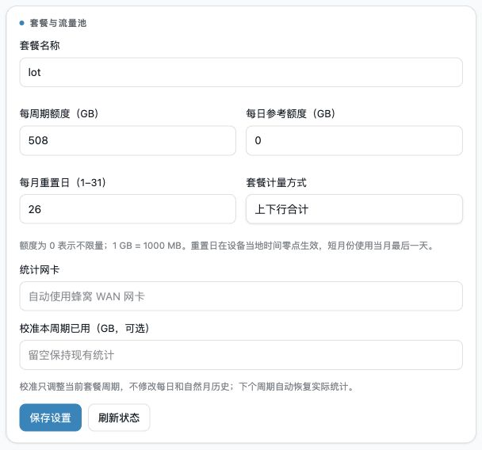

# OpenWrt F50 插件库

面向 ZTE F50 / MU300 OpenWrt 的独立小工具。两项功能可以分别安装、下载、Fork 和修改。

> **0.1.0 实验性源码版**：已做代码审查和隔离测试，但尚未完成 SDK 打包、全新设备安装/卸载、开机以及新 LuCI 页面的实机验收。不是可直接添加到路由器的软件包下载源；暂不提供未经验证的 APK/IPK。不要在唯一的上网设备上直接试装。

## Release 下载

当前首版为 **v0.1.0 实验性预发布**：[下载附件与版本说明](https://github.com/JasonBeam/openwrt-f50-plugins/releases/tag/v0.1.0)。

| 文件 | 内容 |
| --- | --- |
| `openwrt-f50-plugins-v0.1.0-source.zip` | 四个包的完整源码、测试和文档 |
| `f50-ra-refresh-v0.1.0-source.zip` | RA 后台 + 对应 LuCI 源码及安装说明 |
| `f50-xiaojing-v0.1.0-source.zip` | 小鲸后台 + 对应 LuCI 源码及安装说明 |

附件附带 `SHA256SUMS.txt`。按功能拆分的 ZIP 同样是源码，需在匹配固件的 SDK 中构建；不能直接通过 opkg/apk 安装。

[更新记录](CHANGELOG.md) · [贡献指南](CONTRIBUTING.md) · [稳定版验收计划](docs/ROADMAP.md) · [反馈问题](https://github.com/JasonBeam/openwrt-f50-plugins/issues/new/choose)


## 按需选择

| 需要什么 | 纯后台包 | 可选 LuCI 界面 |
| --- | --- | --- |
| IPv6 RA 寿命检查与刷新 | `f50-ra-refresh` | `luci-app-f50-ra-refresh` |
| 小鲸 IoT 流量池校正 | `f50-xiaojing` | `luci-app-f50-xiaojing` |

两个后台包互不依赖；安装界面才会自动选择对应后台。不覆盖固件原有的流量池页面。

### RA 刷新

- 按剩余寿命阈值请求真实 Router Advertisement；默认间隔 3600 秒、阈值 7200 秒。
- 默认只允许逻辑 `wan` 下的 `sipa_eth` 网卡；其他设备需先核对接口再配置。
- **不删除/替换路由、不改 DNS、不重启网络或设备**，不编造无限寿命路由。
- 需要可信来源、与设备架构匹配的 `rdisc6`。本库不附带个人设备上的二进制。
- 不保证运营商一定回应请求，也不修复所有 IPv6 或驱动问题。

### 小鲸 IoT 校正

- 查询小鲸平台，更新当前周期额度和已用量；每日、自然月历史不变。
- 两次同步之间仍使用原流量池的网卡统计；默认间隔 1200 秒。
- **只兼容提供 `unisoc.traffic get/set` 的 MU300 流量池**，不是任意 OpenWrt 通用计费服务。
- 只支持当前小鲸平台接口，不是所有 IoT 卡运营商的通用查询器。
- 查询失败不校正流量池，保留最近成功的平台快照并显示失败/过期状态。
- 卡号和查询验证码存放在后端私有目录，状态接口不读回凭据。
- 默认关闭、默认只尝试 HTTPS；**只有明确勾选风险许可后才使用 HTTP**。HTTP 会暴露查询凭据和结果给链路上的第三方；不会自动降级。
- 平台按 1024 MB/显示 GB 换算，本机原统计仍按原口径累计；运营商数据也可能延迟，不能保证实时账单精度。
- 每月重置日由原流量池管理，插件不会从平台推断结算日，请自行核对。

## 实机截图与现有设置

以下截图来自维护者 F50 上已配置的 LuCI 流量池，拍摄于 **2026-10-16**，不是效果图。
这是本项目整理前已有的设备内集成部署，**不等同于本仓库独立 LuCI 包已完成全新安装验收**；两者的页面入口和布局有所不同。
截图不包含卡号、查询验证码、Cookie 或密钥。显示的流量与剩余量只是拍摄当时的状态，不代表实时余量。

### 流量池与小鲸 IoT 校正

本机网卡累计与最近一次平台校正分别展示，图中可见自动校正状态、周期额度和最近成功时间。


### 套餐设置

此设备示例使用 508 GB 周期额度、每月 26 日重置、上下行合计，网卡自动跟随蜂窝 WAN。
这些只是本机套餐设置，其他用户应填写自己的额度和结算日，不要直接照抄。



### RA 现有部署状态

同日从设备只读查询得到以下输出。RA 现有部署没有网页设置页，因此这里展示真实脚本输出，而非模拟截图：

```text
WAN=sipa_eth0; RA remaining=62401s; interval=3600s; threshold=7200s
```

剩余寿命会随时间变化；该输出证明查询时存在 RA 默认路由，不代表进行了强制刷新测试。
取图期间没有修改流量池、RA、网络或供电设置。

## 下载源码与修改

[下载全部源码 ZIP](https://github.com/JasonBeam/openwrt-f50-plugins/archive/refs/heads/main.zip)，也可 Fork 后修改。
要按功能取用，可以只复制该功能的后台目录及对应 `luci-app-*` 目录。
不要只取一个可执行文件就认为依赖、权限和服务已安装完整。

```sh
git clone https://github.com/JasonBeam/openwrt-f50-plugins.git
```

## 用对应版本的 OpenWrt SDK 构建

在**匹配目标固件**的 SDK/源码树中加入 feed；不要直接在路由器上运行这些构建命令。

```sh
printf '%s\n' 'src-git f50 https://github.com/JasonBeam/openwrt-f50-plugins.git' >> feeds.conf.default
./scripts/feeds update f50
# 只要 RA：
./scripts/feeds install -p f50 f50-ra-refresh luci-app-f50-ra-refresh
# 只要小鲸：
./scripts/feeds install -p f50 f50-xiaojing luci-app-f50-xiaojing
make menuconfig
```

在 menuconfig 选择需要的包，然后编译，例如：

```sh
make package/f50-ra-refresh/compile V=s
make package/luci-app-f50-ra-refresh/compile V=s
```

小鲸对应目标是 `package/f50-xiaojing/compile` 与 `package/luci-app-f50-xiaojing/compile`。
生成 APK 或 IPK 取决于你的 SDK，不要混用包格式、版本或随意安装其他内核的模块。
本库不提供 kmod，不安装/替换 Wi-Fi 或基带驱动。

## 安装前与使用

完整步骤见 [安装、配置和卸载](docs/INSTALL.md)。两项功能均默认关闭，需明确启用。
若已装有同名的私人脚本/服务，**先备份并在测试设备上处理冲突**；不要覆盖生产设备。

安装对应 LuCI 包后，入口在「服务 → IPv6 RA 刷新」和「服务 → 小鲸 IoT 校正」。
纯后台也可用 CLI；凭据不要放在命令行参数、Issue 或日志里。

## 审查与测试边界

见 [代码审查与验收记录](docs/REVIEW.md)。可在开发电脑上运行：

```sh
python3 -m unittest discover -s tests -p 'test_*.py' -v
ruby tests/test_xiaojing.rb
```

测试使用虚拟卡号、模拟运营商及流量池，不会查询真实账号或修改路由。
GitHub Actions 运行相同的源码检查；CI 绿灯**不代表**真实设备的网络、WPA3 或稳定性已验证。

## 参与与许可

欢迎 Fork 或提交 PR。先说明影响范围、兼容性和测试证据，再审查合并；请勿附带卡号或设备备份。
[MIT License](LICENSE) 允许使用、修改和再分发。外部 `rdisc6`、OpenWrt 和 LuCI 依赖仍遵守各自许可。

## 致谢

感谢 [kano / Minikano](https://github.com/kanoqwq) 和 [kaan](https://github.com/dikeckaan)
为 F50 / MU300 的 Linux、OpenWrt 适配、固件及安装工具所做的工作，让这些辅助功能有了可用的平台基础。

- [kano 的 mu300-linux 项目](https://github.com/kanoqwq/mu300-linux)
- [kaan 的 mu300-linux 项目](https://github.com/dikeckaan/mu300-linux)
- [OpenWrt](https://openwrt.org/) 与 [LuCI](https://github.com/openwrt/luci) 社区

本仓库是独立整理的辅助插件，不是上述项目的官方发行物；致谢不表示上游维护者已审查或认可本仓库代码。
