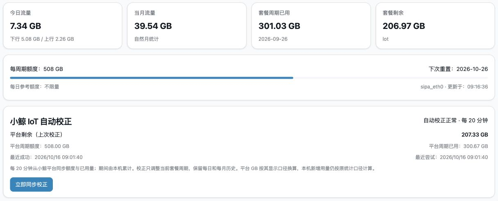

# F50 / MU300 OpenWrt 辅助工具

**按需补充 IPv6 RA 刷新和小鲸 IoT 流量校正，让状态、设置和使用边界更清楚。**

面向 ZTE F50 / MU300 的 OpenWrt 环境。两项功能可以分别使用；已有流量池集成部署，也可以单独查看刷新间隔兼容补丁。

[选择版本与下载](#先选版本与下载) · [安装与配置](docs/INSTALL.md) · [用 AI 帮你上手](docs/AI-GUIDE.md) · [实机截图](docs/SCREENSHOTS.md) · [问题反馈](https://github.com/JasonBeam/openwrt-f50-plugins/issues/new/choose)

> 当前提供**实验性源码**，不是固件，也不是软件包下载源。Release 附件同样是源码 ZIP，不能直接用 `opkg` / `apk` 安装；独立插件需使用匹配固件的 SDK 构建。公开包的全新安装、升级、卸载和独立 LuCI 页面仍待实机验收。

## 先选版本与下载

| 你需要什么 | 应该从哪里获取 | 注意 |
| --- | --- | --- |
| 按固定版本研究或构建独立 RA / 小鲸插件 | [v0.1.1 Release](https://github.com/JasonBeam/openwrt-f50-plugins/releases/tag/v0.1.1) | 最新已发布预发布版本；有版本说明和 SHA-256 校验 |
| 今天新增的 MU300 集成版刷新间隔补丁 | [`main` 最新源码](https://github.com/JasonBeam/openwrt-f50-plugins/archive/refs/heads/main.zip) + [集成说明](integrations/mu300/README.md) | 2026-10-22 新增，**不在 v0.1.1 附件中**；仅用于匹配的已有集成部署 |

**Release 用来固定版本，`main` 用来跟进开发。** 首页与教程会继续更新，旧 Release 附件不会随 `main` 自动变化。需要复现、分享或长期留档时优先使用固定版本；需要尚未发布的新功能时，选择对应源码提交并先核对兼容条件。

### v0.1.1 下载文件怎么选

| 文件 | 内容 |
| --- | --- |
| `openwrt-f50-plugins-v0.1.1-source.zip` | 独立插件完整源码、测试和当时的文档 |
| `f50-ra-refresh-v0.1.1-source.zip` | RA 后台与对应 LuCI 源码 |
| `f50-xiaojing-v0.1.1-source.zip` | 独立小鲸后台与 LuCI 源码，包版本仍为 0.1.0 |
| `SHA256SUMS.txt` | 附件校验值 |

这里的仓库版本、单个包版本和设备固件版本是不同概念。v0.1.1 不表示四个包都变成了 0.1.1，也不表示设备固件被升级。

需要更完整的选择依据，见[main 与 Release 怎么选](docs/VERSIONS.md)。哪些功能适合做成 IPK / OpenWrt APK、如何构建，见[打包建议](docs/PACKAGING.md)。

## 再选使用路线

### 路线一：独立插件

| 功能 | 后台包 | 可选网页界面 | 主要前提 |
| --- | --- | --- | --- |
| IPv6 RA 寿命检查与刷新 | `f50-ra-refresh` | `luci-app-f50-ra-refresh` | 正确的 WAN / 网卡，以及可信、匹配架构的 `rdisc6` |
| 小鲸 IoT 流量池校正 | `f50-xiaojing` | `luci-app-f50-xiaojing` | 已有兼容的 `unisoc.traffic get/set` 流量池服务 |

两个后台互不依赖，均默认关闭；LuCI 包依赖对应后台。构建并安装后，入口为「服务 → IPv6 RA 刷新」和「服务 → 小鲸 IoT 校正」。不会替换固件原流量池页面，也不会创建新的计费流量池。

- **RA 刷新**：观察真实寿命，在需要时请求 RA，并核对实际续期；不删路由、不改 DNS、不重启网络。不保证运营商回应，也不修复所有 IPv6 问题。
- **小鲸校正**：用平台数据校正当前周期额度与已用量，保留原每日、自然月历史；独立插件默认 HTTPS，不自动降级到 HTTP。

操作步骤见[安装、配置和卸载](docs/INSTALL.md)，详细行为见[功能与数据口径](docs/FEATURES.md)。

### 路线二：已有 MU300 流量池的兼容补丁

如果你的设备已经使用 `f50.iot` 集成版，且文件结构与[集成说明](integrations/mu300/README.md)一致，可研究 2026-10-22 新增的间隔补丁：

- 在原小鲸同步按钮旁设置 **5–1440 整数分钟**，默认 20 分钟。
- 保存只修改间隔，保留卡号、SIM 绑定、额度和流量历史；自动任务每 5 秒读取设置，无需重启网络。
- 补丁工具只处理开发电脑上的**离线目录副本**，不连接设备、不自动上传，也不是独立插件安装器。

这条路线与独立 LuCI 插件的 **300–86400 秒**设置不同。不要将两套代码混装，也不要同时启用两个小鲸校正后台。旧集成部署的 HTTP 请求方式不会因这个间隔补丁自动变成 HTTPS。

## 页面长什么样



这是维护者设备上已有的集成部署，**不是独立 LuCI 包全新安装的验收截图**，也不是 2026-10-22 新间隔控件的截图。更多页面、设置口径与历史 RA 输出见[实机截图记录](docs/SCREENSHOTS.md)。

## 不熟悉命令？让 AI 先帮你判断路线

[AI 上手教程](docs/AI-GUIDE.md)提供兼容性检查、源码构建、离线补丁和脱敏排错的提示词。AI 是可选助手，不是插件运行依赖，也不能代替匹配固件的 SDK 或真实设备验收。

先复制这一段：

```text
我想了解 https://github.com/JasonBeam/openwrt-f50-plugins 。
请先阅读当前 README、docs/INSTALL.md、docs/AI-GUIDE.md，
如果目标是已有 MU300 集成版，再读 integrations/mu300/README.md。
我想实现【RA 刷新 / 独立小鲸校正 / 已有集成版调整刷新间隔】。
请先判断我应该选哪条路线、用 Release 还是 main；不能读取链接时请明确说明。
先给出需要我提供的脱敏设备信息与只读检查步骤，不直接安装或修改设备。
不要索取密码、卡号、验证码、Cookie、私有配置或完整设备备份。
不要把源码 ZIP 当成 IPK/APK，不要混用独立插件与集成补丁。
```

## 验证到哪一步

- 源码检查与隔离测试覆盖 RA 策略、小鲸校正、失败保留、锁与间隔配置；不使用真实卡号，不修改真实路由或流量池。
- 维护者已有集成部署验证过间隔控件显示、确认保存、20→30→20 分钟回读和原数据保留；没有等待完整周期或完成全新设备安装验收。
- SDK 构建、独立 LuCI 页面的设备交互、开机、升级与卸载仍需分别验证。CI 通过不等于任意固件上都能安装，也不代表 Wi-Fi、WPA3 或整机稳定性已验证。

[审查记录](docs/REVIEW.md) · [后续验收计划](docs/ROADMAP.md) · [更新记录](CHANGELOG.md)

## 开发、贡献与许可

```sh
git clone https://github.com/JasonBeam/openwrt-f50-plugins.git
cd openwrt-f50-plugins
python3 -m unittest discover -s tests -p 'test_*.py' -v
ruby tests/test_xiaojing.rb
ruby tests/test_iot_interval.rb
```

以上在开发电脑运行。SDK 构建方法见[安装文档](docs/INSTALL.md#在匹配的-sdk-中构建独立插件)，发布和打包说明见[贡献指南](CONTRIBUTING.md)。

欢迎按功能 Fork、提交 Issue 或 PR，请附兼容范围和验证结果，不附个人凭据或设备备份。[MIT License](LICENSE) 允许使用、修改和再分发；外部 `rdisc6`、OpenWrt 和 LuCI 依赖遵守各自许可。安全问题见 [SECURITY.md](SECURITY.md)。

## 致谢

感谢 [kano / Minikano](https://github.com/kanoqwq) 和 [kaan](https://github.com/dikeckaan) 为 F50 / MU300 的 Linux、OpenWrt 适配、固件及安装工具所做的工作。

- [kano 的 mu300-linux 项目](https://github.com/kanoqwq/mu300-linux)
- [kaan 的 mu300-linux 项目](https://github.com/dikeckaan/mu300-linux)
- [OpenWrt](https://openwrt.org/) 与 [LuCI](https://github.com/openwrt/luci) 社区

本仓库是独立整理的辅助工具，不是上述项目的官方发行物；致谢不表示上游维护者已审查或认可本仓库代码。
